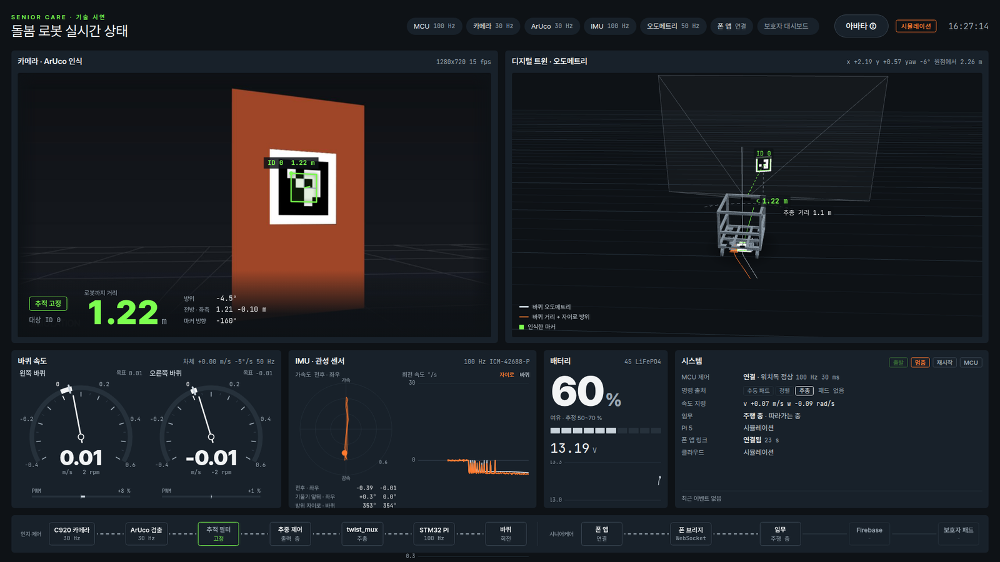
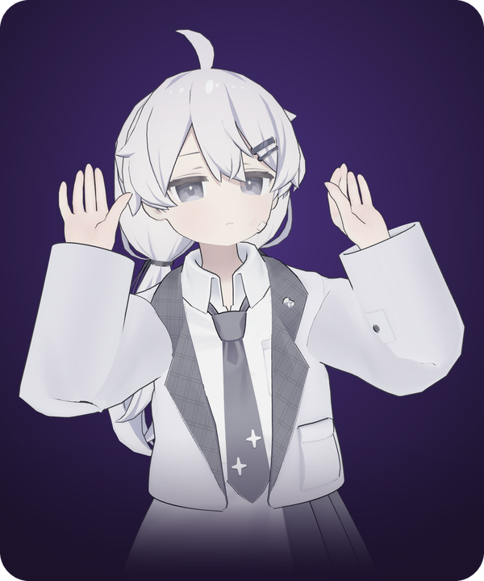

# mobile-robot-booth

[막내 로봇](https://github.com/next-year-robotics/mobile-robot)을 시연할 때 노트북에 띄운 대시보드다. 로봇(RPi5)의 ROS 2 토픽을 받아 카메라와 ArUco 인식, 디지털 트윈, 바퀴 속도, IMU, 배터리, 시스템 상태를 한 화면에 보여 준다. 관람객에게 로봇을 소개하는 아바타 화면도 같이 있다.

<p align="center"></p>
<p align="center"><sub>가상 로봇(<code>--sim</code>)으로 띄운 화면</sub></p>

<p align="center"></p>

## 구성

```text
RPi5 (ROS 2 Jazzy) ──DDS, Wi-Fi──▶ 노트북 bridge/ (rclpy) ──WebSocket──▶ 브라우저 web/ (Vite, three.js)
```

브리지는 노트북에서 돌고, 모든 토픽을 BEST_EFFORT로 받아 로봇 쪽에 부담을 주지 않는다. 영상은 압축 토픽을 풀지 않고 그대로 브라우저로 넘긴다. 카메라 위에 그리는 마커 상자는 노트북이 다시 검출한 것이 아니라 로봇이 낸 마커 자세를 카메라 보정값으로 되투영한 것이다. 3D 화면의 흰 선은 `/odom`, 주황 선은 바퀴 거리에 자이로 방위를 붙여 다시 적분한 경로다.

`robot/`에는 Pi에서 도는 것들이 있다. systemd 유닛(`mr-booth.target`)이 부팅 때 로봇 스택을 띄우고, 패드 노드가 Xbox 패드 버튼을 출발과 멈춤 명령으로 바꾼다.

아바타는 [three-vrm](https://github.com/pixiv/three-vrm)으로 VRM 모델을 그린다. 미리 녹음한 자기소개 음성에 맞춰 입모양과 몸짓을 움직이고, ElevenLabs Agents로 관람객과 음성 대화를 한다. 로봇 상태를 물으면 대시보드가 받은 값으로만 답한다.

## 실행

ROS 2 Jazzy와 Node.js 22가 필요하다. 처음 한 번은 웹 의존성을 받고, 옆 폴더의 `mobile-robot`에서 메시지 패키지를 빌드한다.

```bash
(cd web && npm install)
scripts/build_msgs.sh
```

```bash
scripts/run.sh            # 실제 로봇
scripts/run.sh --sim      # 노트북 안의 가짜 로봇 (ROS 도메인 77, 이 노트북 밖으로 안 나간다)
scripts/check_robot.sh    # 시작 전 점검
```

Chrome 앱 창이 전체 화면으로 뜨고, 터미널에서 Ctrl+C를 누르면 전부 내려간다. 멀티캐스트가 막힌 Wi-Fi에서는 `--peer <Pi IP>`로 Pi 주소를 직접 알려 준다.

| 키 | 동작 |
| --- | --- |
| 1, 2 | 대시보드, 아바타 |
| 4, 5, 6 | 3D 시점: 뒤따라가기, 회전, 위에서 |
| R | 경로를 지우고 다시 맞춤 |
| S, Space | 출발, 멈춤 |
| V (아바타 화면) | 누르는 동안 말하기 |

## 로봇 쪽 설정

Pi는 `~/.ssh/config`의 `rpi5` 호스트로 접속한다. `robot/` 파일과 systemd 유닛은 아래 명령으로 넣는다.

```bash
scripts/robot.sh install    # 처음 한 번, robot/을 고친 뒤
scripts/robot.sh status     # 유닛 상태와 최근 경고
scripts/robot.sh log pad    # 유닛 로그 (follow, phone_bridge, mission, telemetry, pad)
```

| 패드 | 동작 |
| --- | --- |
| A | 출발. 폰 앱의 출발과 같은 명령이라 앱에도 주행 중으로 뜬다 |
| B | 멈춤 |
| LB 또는 RB를 쥐고 왼쪽 스틱 | 수동 조종. 놓으면 다시 따라가기로 돌아간다 |
| View + Menu 3초 | Pi 끄기 |

설정은 `config/booth.yaml`에 있다. 로봇의 물리 상수는 mobile-robot이 원본이고 여기에는 사본을 둔다.

## 아바타 파일

VRM 모델, 모션, 자기소개 음성은 라이선스 때문에 저장소에 넣지 않았다. 직접 구해서 `web/public/avatar/`에 `platinum.vrm`, `introduction.mp3`, `motions/`로 둔다. 파일이 없어도 대시보드는 그대로 돈다.

음성 대화를 쓰려면 ElevenLabs에서 Agent를 만들고 `config/booth.yaml`의 `live.agent_id`를 채운 뒤, API 키를 `~/.config/booth_dashboard/elevenlabs_api_key`에 둔다. 키는 브리지만 읽고, 브라우저에는 잠깐 쓰는 서명된 접속 주소만 넘긴다.

시연에 쓴 모델은 有坂みと의 プラチナ(VN3 라이선스)다.

## 시험

```bash
(cd bridge && python3 -m pytest -q)
(cd web && npm run typecheck && npm test)
```

## 라이선스

[Apache-2.0](LICENSE). 아바타 모델, 모션, 음성 파일은 포함되지 않으며 각 파일의 이용 약관을 따른다.
